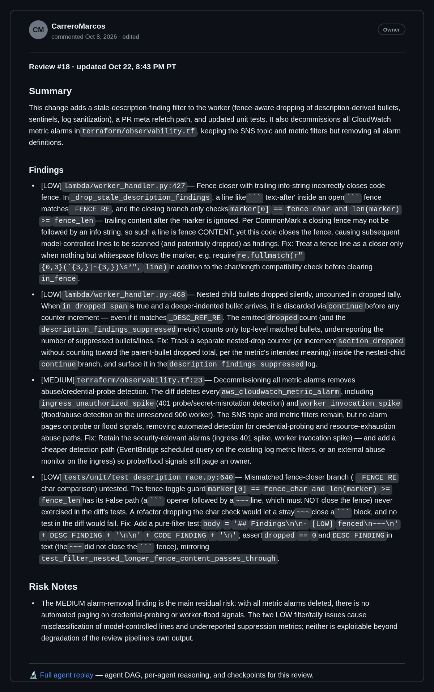

# PR Reviewer

A small serverless bot that reviews your pull requests for you. No servers to run. No comment spam. Just one helpful review that stays up to date.

---

## See it work



*The bot's canonical review on [PR #177](https://github.com/CarreroMarcos/pr-reviewer/pull/177) — a real pull request, reviewed by the same bot this repo ships. One comment, updated in place on every push, with a full agent replay linked in the footer. (Image rendered from the comment's live markdown source.)*

---

## By the numbers (as of Oct 2026)

- **177 pull requests** in this repo's history — the bot reviews its own PRs, one canonical review comment per PR, updated in place.
- **220 commits** on main.
- **Over 3× more tests than code.** 32,205 lines of tests against 10,172 lines of runtime Python.
- **A 15-case pinned model-eval corpus** (13 scored defect cases + 2 robustness probes) the pipeline is scored against in CI.
- **$0/mo** — the whole thing fits inside the AWS free tier.

*Counts are a snapshot from Oct 23, 2026 and drift as the repo grows — the ratios are the point, not the exact figures.*

---

## Start here in 2 minutes

1. This README — what the bot does and how it works.
2. [`ARCHITECTURE.md`](ARCHITECTURE.md) — the design, including the fencing protocol that keeps one comment per PR safe.
3. [`DECISIONS.md`](DECISIONS.md) — why it is built this way.
4. [PR #177](https://github.com/CarreroMarcos/pr-reviewer/pull/177) — a real review from the bot, agent replay linked in the footer.

---

## Why this exists

Waiting on a first review slows everything down. Most review bots don't help much. They post a new comment on every push. They need servers that cost money and need care. And when pushes come fast, an old review can overwrite a new one.

This bot aims to act like a thoughtful teammate: quick, quiet, and never out of date.

### One comment per PR

Each pull request gets exactly one review comment. That's the rule.

- Open a PR, and the bot posts a review.
- Push new commits, and the bot updates that same comment.
- If webhooks arrive late or out of order, the bot drops the stale one. Newer code always wins. We call this revision fencing.
- Draft PRs are left alone until you mark them ready.

---

## How it works

Everything runs on AWS, and only when there's work to do. Nothing idles in the background.

```text
[ PR opened / updated on GitHub ]
              │
              ▼  webhook (checked with a shared secret)
┌─────────────────────────┐
│     Ingress Lambda      │  ── replies to GitHub within a few hundred milliseconds
└────────────┬────────────┘
              │  job goes to queue
              ▼
┌─────────────────────────┐
│     SQS Work Queue      │  ── holds jobs safely during spikes
└────────────┬────────────┘
              │
              ▼
┌─────────────────────────┐
│      Worker Lambda      │  ── 1. grabs the code diff
└────────────┬────────────┘     2. runs multi-agent review pipeline:
             │                     3 specialists (correctness, security, tests)
             │                     → verifier → synthesizer
             │                     (fast single-pass fallback for docs-only PRs / contention)
             │                  3. checks it has the newest commit
             │                  4. saves run events & meta to S3
             │                  5. creates or updates the one comment
             ├───────────────────────────────────────────┐
             ▼                                           ▼
┌─────────────────────────┐                 ┌─────────────────────────┐
│   The one PR comment    │                 │   S3 Archives Bucket    │
│  (canonical + replay    │                 │   (90-day retention)    │
│   link in footer)       │                 └────────────┬────────────┘
└─────────────────────────┘                              │
                                                         ▼
                                            ┌─────────────────────────┐
                                            │      Viewer Lambda      │ ── serves replays via
                                            │      (Function URL)     │    [🔬 Full agent replay]
                                            └─────────────────────────┘
```

1. **Ingress (the greeter).** Checks the webhook is really from GitHub. Skips drafts and repeats. Puts the job on a queue. Replies within a few hundred milliseconds.
2. **Queue (the waiting room).** A durable SQS queue holds each job. Busy hour? Jobs wait their turn. Nothing gets lost.
3. **Worker (the reviewer).** Reads the diff. Runs the live multi-agent review pipeline (`MULTI_AGENT=1`): three specialists in correctness, security, and tests analyze the diff, a verifier checks candidate findings, and a synthesizer publishes the canonical review comment. Fast single-pass review is used for documentation-only PRs (T076/T079) and mutex contention fallback (D9). Every review is archived to S3, with a live replay viewer linked in the comment footer.
4. **Memory (DynamoDB).** Tracks each delivery, each commit, and who holds the review lock. This is what makes stale updates safe to drop.

---

## What you get

- **One tidy comment.** No threads piling up on every push.
- **Multi-agent review.** Three specialists (correctness, security, tests), a verifier, and a synthesizer collaborate to produce high-fidelity reviews. Fast single-pass review serves as fallback for documentation-only PRs (T076/T079) and mutex contention (D9).
- **Full history in S3, replay built in.** Every review — input and result — is archived for 90 days in S3. A live viewer Lambda deployed behind a Function URL is linked in the footer of every canonical review comment (`[🔬 Full agent replay]`), letting you inspect the full agent reasoning and run timeline in the browser.
- **Safe under pressure.** Late or duplicate webhooks are thrown away, never posted over fresh work.
- **Nearly free to run.** It fits inside the AWS free tier today. Lambda, queue, database, storage, and secret store all included.
- **Careful with secrets.** GitHub checks use HMAC signatures. Tokens live in SSM as locked secrets, never in code. Each function only gets the access it needs. The AI only reads code — it can't run anything or touch your cloud.
- **Small and boring (on purpose).** Python 3.12, standard library plus boto3. Nothing else at runtime. All infrastructure is Terraform.

---

## Repo layout

- [`lambda/`](lambda/) — the code: `ingress_handler.py`, `worker_handler.py`, `viewer_handler.py`, shared helpers in `lambda/common/`.
- [`terraform/`](terraform/) — all AWS setup as code: Lambdas, queue, database, storage, roles.
- [`prompts/`](prompts/) — the instructions we give the AI reviewer.
- [`tests/`](tests/) — unit, state-machine, contract, model-eval, and integration tests.
- `README.md` — this file.
- [`ARCHITECTURE.md`](ARCHITECTURE.md) — how the system is designed: components, data flow, and the fencing protocol.
- [`DECISIONS.md`](DECISIONS.md) — why it is built this way, decision by decision.
- [`OPERATIONS.md`](OPERATIONS.md) — running it day to day: deploys, kill switch, redrive.

---

## What's next

Planned work is all review quality: inline comments anchored to the exact lines they're about, GitHub App tokens so repos can install the bot without sharing a personal token, and whole-file context so reviewers see the code around a diff, not just the diff itself. The maintained roadmap lives in [`ARCHITECTURE.md`](ARCHITECTURE.md).

---

## Run it locally

Uses [`uv`](https://docs.astral.sh/uv/) for Python setup. Commit hooks (`pre-commit run --all-files`) run the same checks CI does.

```bash
# Install everything
uv sync --frozen --group dev

# Run the tests
uv run --frozen pytest -q --tb=short

# Check style
uv run --frozen ruff check .
uv run --frozen ruff format --check .

# Check infra without touching AWS
terraform -chdir=terraform init -backend=false
terraform -chdir=terraform fmt -check
terraform -chdir=terraform validate
```
